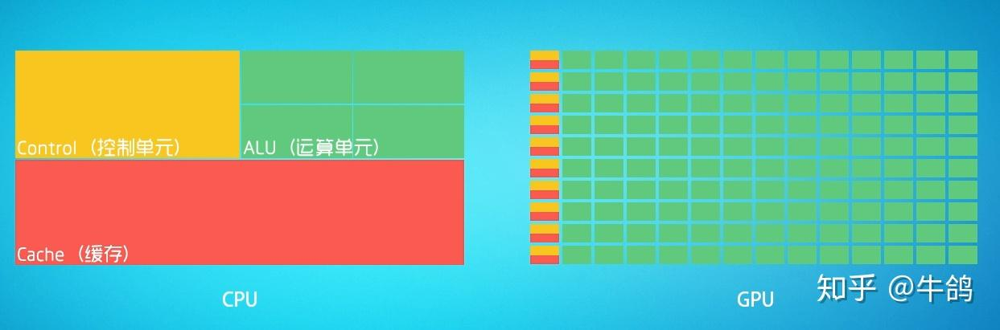

# FernLearnOpenGL

这个库是我用来学习怎么使用OpenGL的。
成果会变成这个库下的Commit。

与我另外一个计算机图形学项目不同：

- Fern3DGameEngine 的重点在于 **刻意避开成品图形库以学习基本原理**
- 这个库的重点在于 **拥抱成品库并学习使用一个趁手的工具**

在最初的提交前我请AI代劳，检查了我的OpenGL安装情况，并在我的电脑上安装了GLFW和GLAD，并且生成了一个可运行的cpp文件，帮我确认了库安装正确。  
然后顺便叫他帮忙整理了一份 API 文档方便快速上手。  
参见：***./docs/OpenGL_API清单.md***  


## 开发日志

### 2026-10-17

#### **15:28**

源文件更新

- 现在的源文件应该实现目标2-1：在屏幕上渲染出一个三角形
    - > 配色有点丑，但是不影响我已经画出三角形的事实。

文档更新

- OpenGL 概念详解
    - > 在实际开发过程中，我发现这一个部分的代码是最难从数学原理出发去实操的，因为这里基本上全是硬件级别的操作，并且遇到了三个核心的问题。  

      > 我手动写的矩阵除法，其实在硬件上早有自动的实现。
      > 也就是从这里我了解到为什么OpenGL采用了看起来如此这般复杂的设计。  
      > 首先有一个问题，而且这个问题很直观：我的主项目运行起来观感很慢。  
      > 与此同时，我在观看 AI 给我的参考实现的时候发现这套实现运行起来观感很快。  
      > 上网查询一下资料，我查到了 CPU 和 GPU 的本质区别：  

      

      > 图上最明显的差别就是，CPU 的计算单元少，通常只有几个，而 GPU 的运算单元有很多个（图里有100，实际可能上千）。  
      > 这使得 GPU 天然适配大量并行、彼此独立、计算简单的任务。  
      > CPU 全称是中央处理器，而 GPU 全称是图形处理器。它在诞生之初就是为了加速图形渲染的，而图形渲染本质上就是一个大量并行、彼此独立、计算简单的任务。

      > 几乎大部分对于我来说难懂的 API 都是操作硬件尤其是 GPU 的，而我在主项目中完全没有 GPU 相关的操作代码。这也就意味着，我的渲染引擎是仅靠 CPU 跑起来的。  
      > 而使用 GPU 向屏幕上渲染一个三角形，本身这个渲染的管线就涉及大量的硬件级处理。  

      > 然后，第二个问题，我在看参考实现的时候在文件开头发现了两串不明所以的字符串，在当前目标中 API 清单也在提醒我写一个这样莫名其妙的字符串。  
      > 与此同时我还遇到了一个好久没有遇到的名词：编译。
      > 编译什么？编译成什么？为什么要编译？编译的产物是什么玩意，谁在用？

      > 其实答案也藏在两种处理器的不同原理里面。C ++ 经过编译器一系列的处理最终变成汇编，本质上是CPU可以识读的机器码，对于CPU来说是一个可执行文件。  
      > 只是这里的”编译“稍有不同：OpenGL的编译面向GPU。  
      > 我照葫芦画瓢写的那串不明所以的字符串其实也是一门编程语言。它的正式名字叫 ***GLSL***，可以被OpenGL编译为由GPU执行的程序，并下发到成百上千个GPU计算核心中。对理想并行浮点计算的计算效率变成CPU串行计算的成百上千倍。  
      > 光栅化、逐像素绘制是GPU的老本行，如果让 CPU 霸王硬上弓，那么 CPU 需要按照串行计算，会产生大量的函数调用与循环控制，严重拖累整体速度。

      > 第三个问题就是，为什么必须要执行这么多复杂的操作，我看代码看不明白每一个组件是什么，起什么作用。  
      > 答案其实出在硬件机制上。CPU 能读内存，GPU 能读的内存不叫内存，叫显存。然而 GPU 读不了内存。所以任何想要被渲染到屏幕上的东西，经历的第一道关卡就是从内存到显存的拷贝。  
      > 这个操作由OpenGL封装的 `glBufferData(GL_ARRAY_BUFFER, sizeof(vertices), vertices, GL_STATIC_DRAW);` 完成。

      > 被拷贝到显存的数据真的就只是数据。这些数据由一个东西，简称是 VBO ，全称是 Vertex Buffer Object 管理，本质上只是显存里面的一个数据数组。  
      > GPU 光拿到这个还不够，必须拿到属于它的”飞虎队解密卡“——就是 VAO ，全称是 Vertex Array Object ，它指导 GPU 如何读取显存的数据。
      > OpenGL 里面提供了两个函数
      ```cpp
      void glVertexAttribPointer(GLuint index, GLint size, GLenum type,
                           GLboolean normalized, GLsizei stride,
                           const void* pointer);
      glEnableVertexAttribArray(0)
      ```
      > 用于配置”解密卡“。

      > 今天我第一次真正接触到 GPU 绘图，从体感上来说是一种别开生面的体验。  

      > 核心的三大疑问都被解决的同时，我还发现了一件事情：不同 GPU 能跑的指令集是不同的。  
      > 这也是为什么编写 GPU 代码需要单开一种语言叫 GLSL 。它存在的意义就是抹平不统一。  
      > 正因为各厂商发布的显卡指令集是不同的，甚至同一家厂商发布的不同型号的卡，同型号不同版本的卡都有可能在驱动上有差异，使得发布一个预编译版本的二进制文件给所有显卡是不可能做到的。  
      > GLSL 作为对接这个需求的高级语言应运而生，其最大的优点恰恰是可以根据运行电脑的显卡型号精准匹配编译方法和产物。  
      > 这样一来，卡本身之间的差异就会被这门语言的特性几乎抹平，在不同卡上运行同样程序的结果就可以做到高度可移植。  
      > 尤其是在看重**跨设备一致性**的开发需求的时候要求更为严格，比如物理仿真模拟引擎。  

      > 影响跨设备一致性的除了指令集，还有约定俗成的标准。  
      > OpenGL 把标准分为三类：规范强制、实现定义、允许差异。标准等级一个比一个松。  
      > 虽然 GLSL 具有可移植的优点，但是并非移植到哪里都一样。标准是不一样的。GLSL 只能保证”语义可移植“，不负责保证”结果可复现“。  
      > 定制化开发填补的就是这个灰色地带。

#### **12：43**

文档更新

- 以 .md 文件形式统一整理我在实际开发过程中接触 OpenGL API 的时候遇到的问题，并通过 AI 翻找本地库的注释等权威文档或记录得到答案。
    - 见 ./docs/OpenGL学习问答.md。
    - > 虽然我现在只能看懂一部分，但是我相信随着学习的深入我最终可以看懂并理解全部，以后有人照例问我我也能回答出来。

#### **11：20**

源文件更新

- 完善帧循环
    - 现在窗口颜色不再是“随机的”，而是“我让他是啥他就得是啥”。
    - 视口映射现在有调用实现了。
- 添加了大量注释，内容是我关于 API 的笔记。包括
    - 每帧查询帧缓冲尺寸并设置视口，适配窗口缩放
    - glClearColor + glClear 清颜色与深度缓冲
    - 验证：实测 0~255 传参会被钳为 (1,1,1,1)，改用具名颜色/255.0
- 增加最小化（0x0 帧缓冲）防护
- include 路径改用 AdditionalIncludeDirectories 提供的 include 根

#### **10：15**

源文件更新

- 完善帧循环，调用双缓冲交换函数，现在窗口应该黑黑的了

Bug修复

- **程序崩溃**
    - 发现途径：
        - 删去打印版本号之后返回值从 0xcfffffff 变成 0。
    - Bug 根因定位：
        - 缺少在打印版本号函数调用之前必需的动态取函数函数调用。
        - > 文档里面写明了我需要调用这个函数才能打印版本号。这的确帮我省下了不少时间。
    - 解决方法：
        - 如代码。现在加回版本号打印函数。现在版本号的输出为：
        - > 4.6.0 - Build 31.0.101.2137  
          >  
          > D:\Developing\C++\FernLearnOpenGL\x64\Debug\FernLearnOpenGL.exe (进程 16216)已退出，代码为 0 (0x0)。

#### **09：47**

源文件更新

- 添加帧循环
- 窗口会在空格或A被按下的时候主动关闭。
- 现在窗口应该还是白色的，因为我没有设置交换缓存。

#### **05：31**

源文件更新

- 新建源文件
- 旧的源文件（AI生成参考实现）更改后缀为.txt并归档

现阶段运行成果

- 顺利编译运行，黑框框一闪而过，控制台显示进程已退出且代码为0。
    - > 需要说明的是，这是预料之内的，我没有添加任何循环。

#### **04：42**

初始化本地和远程仓库。将验证过后可以跑通的程序打包上传以便回滚。


