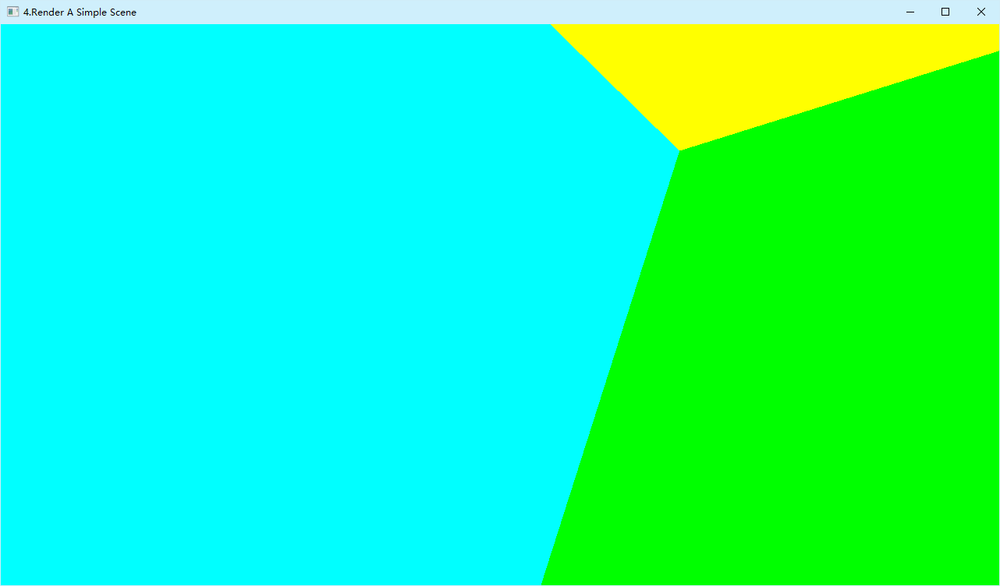
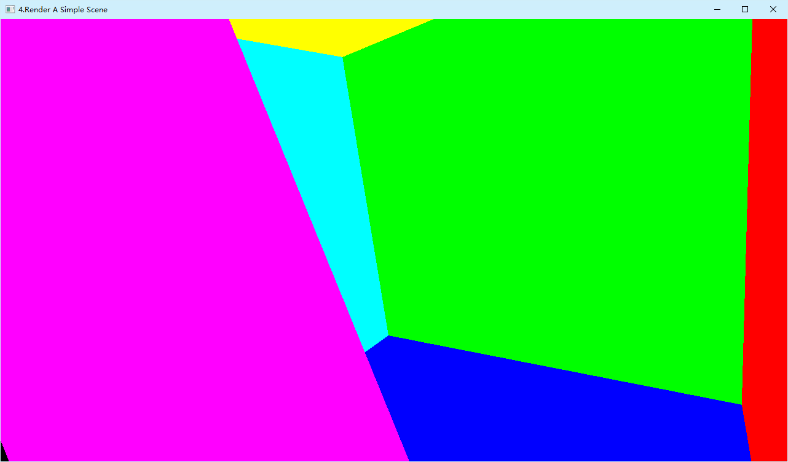
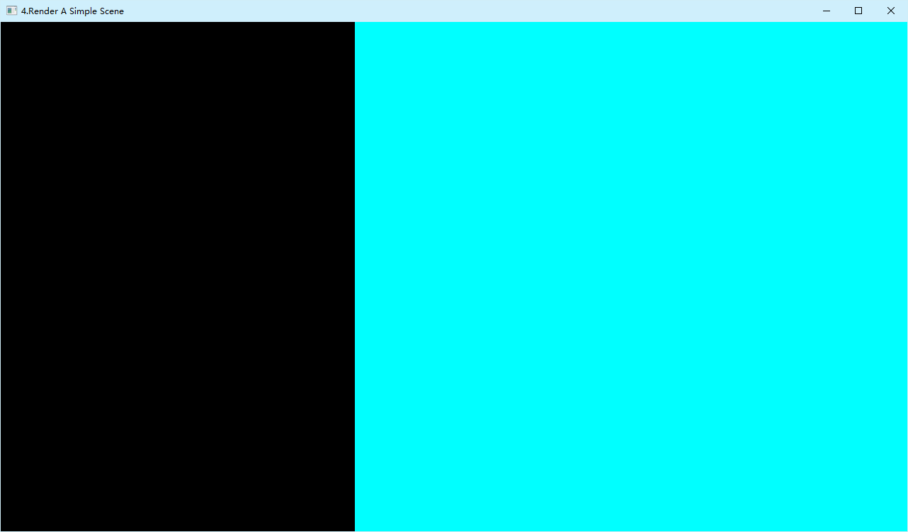
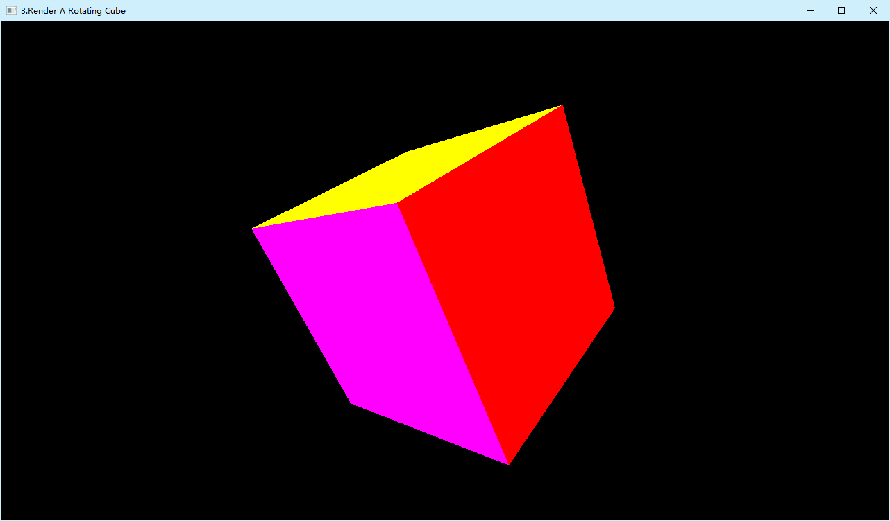
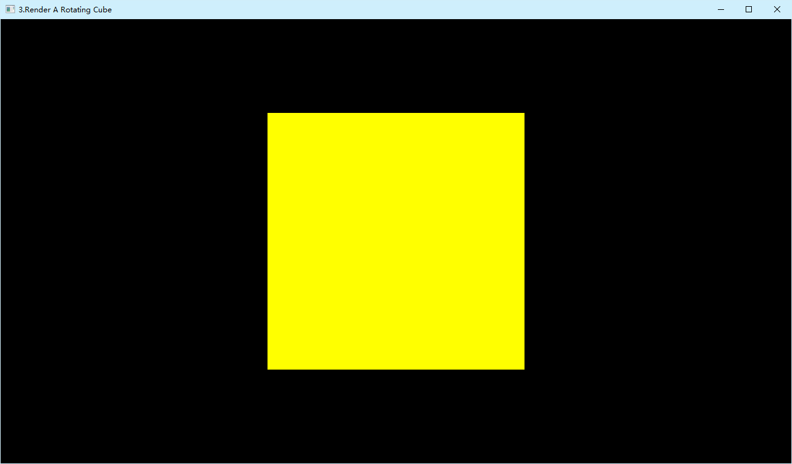

# FernLearnOpenGL

这个库是我用来学习怎么使用OpenGL的。
成果会变成这个库下的Commit。

与我另外一个计算机图形学项目不同：

- [Fern3DGameEngine](https://github.com/Rimuru40965535/Fern3DGameEngine)  的重点在于 **刻意避开成品图形库以学习基本原理**
- 这个库的重点在于 **拥抱成品库并学习使用一个趁手的工具**

在最初的提交前我请AI代劳，检查了我的OpenGL安装情况，并在我的电脑上安装了GLFW和GLAD，并且生成了一个可运行的cpp文件，帮我确认了库安装正确。  
然后顺便叫他帮忙整理了一份 API 文档方便快速上手。  
参见：***./docs/OpenGL_API清单.md***  


## 开发日志

### 2026-10-18

#### **12:33**

源文件更新

- 验证：近平面之后的几何被裁切

  > 此处的内容需要在代码中手动调整注释以选择矩阵定义，并编译运行。  

    - 把观察矩阵设为单位阵，即相机置于立方体内部
    
      > 选择观察矩阵为单位矩阵、正常的投影矩阵。  
      > 选择观察矩阵为GLFW时间驱动的压入正方体的观察矩阵，并运行至第20秒时，观察矩阵恰为单位矩阵。因此在此时间定格截图：

      

      > 观察：近平面(z=near)之后的几何（整个 −Z 面、以及四周侧壁靠近相机的一半）被裁掉，未出现顶点 w≤0 导致投影符号翻转、横穿屏幕的巨型三角形

    - 逐渐把相机压入正方体。
      
      > 选择观察矩阵为GLFW时间驱动的压入正方体的观察矩阵、正常的投影矩阵。  
      > 肉眼可以看见平面被裁切的过程一闪而过。裁切边缘始终是直线，说明裁切的剪刀是一个平面。

      
      
      

    - 进一步把 near 从 0.1 递增，可见正方体被豁开，露出背后不可见的面，然后豁口逐渐将正方体吞噬，最后剩下纯黑画面，说明是近平面在决定裁切范围
    
      > 选择正常的观察矩阵、投影矩阵为GLFW时间驱动的近平面有递增项的投影矩阵。  

      [▶ 近平面递增演示（mp4，9.62 MB）](docs/近平面递增.mp4)

    - 推论（依据规范，非本次实验直接测得）：裁切发生在裁剪空间、透视除法之前，
      属固定功能硬件行为，因此无法在着色器中复现（片元着色器执行时除法已发生、插值已错）

- 数据
    - 立方体顶点扩展为 位置(3)+颜色(3)+法线(3)=9 float，36 顶点，实测 1296 字节
    - 法线逐面共享：8 顶点 + 索引无法表达逐面法线，故顶点必须拆开
    - 新增地面四边形（6 顶点，实测 216 字节），法线统一 (0,1,0)
    - 已用叉积逐三角形校验绕序与属性法线一致性：立方体 12/12 通过

- 属性配置
    - stride 24 → 36
    - 新增插槽 2：法线，offset 24


- 本提交尚未包含
    - 地面 VAO/VBO：数据已备好并验证字节数，尚未上传
    - 着色器法线输入与光照
    - 正式机位：当前 view 为 `Translation(0, 0, 4)` ，专用于裁切验证

- 需要在下一提交删除的部分
    - 事件处理过程中的临时管线

### 2026-10-17

#### **23：07**

里程碑更新：两条管线的对照

同一个立方体，两条完全独立实现的渲染管线：

| | 软件光栅化管线 | OpenGL GPU 管线 |
|---|---|---|
| 仓库 | [Fern3DGameEngine](https://github.com/Rimuru40965535/Fern3DGameEngine) | [FernLearnOpenGL](https://github.com/Rimuru40965535/FernLearnOpenGL) |
| 光栅化 | Bresenham* + 扫描线填充 | 硬件固定功能 |
| 矩阵变换 | 手写 `Matrix4x4`（行主序存储） | 复用 `Matrix4x4`，转置后上传 GPU |
| 深度测试 | 手写 `DepthBuff` 二维数组比较 | `glEnable(GL_DEPTH_TEST)` |
| 属性插值 | 手写 `LiniarInterpolation` | 硬件插值 |
| 逐像素上色 | 手写 `putpixel` | 片元着色器 |

> \*表明实际内容为AI生成

两个仓库的最小可用物体渲染管线效果图对比如下

|  CPU 侧(Fern3DGameEngine)里程碑更新时的最小渲染管线  |  GPU 侧(FernLearnOpenGL)里程碑更新的最小渲染管线 | 
| :--------------------------------: | :-----------------------------: |
|||
| 屏幕大小：1200 x 900 | 屏幕大小：1280 x 720|


两者的**透视与遮挡行为**一致——因为它们用的是**同一套数学**。

> 目前为止我接触OpenGL才不到 24 小时。  
> 
> OpenGL 给我的第一印象是配置与使用步骤繁多，比较麻烦，不如 EazyX 的开箱即用。
> 其实这也是没有办法的事情，在前面的更新（需要向下翻）中有我对于CPU和GPU架构和原理层面的讨论，也载明了技术上不可能用一套指令集统一GPU的遗憾。
> 不过现在 AI 工具横空出世，利用 AI 工具可以直接对本地文件进行读取并改写。
> 这可以让我跳过极易出错的配置步骤并且快速上手熟悉 API。  
> 
> 它给我的第二印象是运行迅速，渲染迅速。
> 前文有我对于这个“迅速”的体感描述，随着学习的深入我才知道这是 CPU 和 GPU 的固有差异带来的优势。
> 
> 它给我的第三印象是需要手动组织 API 的调用。OpenGL 是隐式状态机，意味着函数的执行不取决于参数，而取决于“我之前做了什么”。  
> 虽然说这种形式的优点是省参数，给予驱动优化空间，但是代价是需要在脑子维护一份关系网。最糟糕的是，出错的时候是静默的，它不报错。  
> “隐式状态机”这个术语和多态一样，是一个我已经在用但是不自知的概念。  
> [Fern3DGameEngine](https://github.com/Rimuru40965535/Fern3DGameEngine) 中我使用的平面图形库叫 EazyX ，其cleardevice()函数通过读取隐藏的背景色达成不指定参数即可清屏的功能。  
> 
> 最后它给我的印象，而且也是冲击最大，直接导致我考虑在之后的开发中学完渲染管线的原理及优化技巧之后切换到 OpenGL 进行后续开发的印象，就是这个库开发起来太快了。  
> 我一看建仓时间是今天凌晨的 04：42，我敲下这行文字的时间是 22：59，仅用约 18 小时的时间，就追平了我在主仓库花了几天才实现的第一个里程碑更新 ~~（甚至我今天还坐了将近两小时的校园大巴从秦淮跑去江宁听课）~~ 。  
> 
> 在实际编程开发的时候，我也暴露出自身的一个缺陷：我 API 记得不是太熟。
> 不过我相信随着我学习的深入这些 API 迟早会成为我的老朋友。

源文件更新

- 实现目标3：渲染出一个可旋转的正方体
    - 顶点数据为 36 个顶点（12 三角形），每顶点 6 个 float（位置 + 颜色），测试网格数据使用了 AI 生成的数据。
    - 立方体六个面六种颜色，用于肉眼验证深度测试
    - 矩阵使用自研 `Fern::Matrix4x4`，按 `model * view * proj` 合成后自行实现为转置上传
        - > 关于为什么实现转置，是因为已有的矩阵是行主序的存储，而 OpenGL 会按列主序来理解我的矩阵。  
          > 虽然也可以在第三参数中传入 `GL_TRUE` 让驱动代劳，但是为了保持可移植性，OpenGL ES 要求这里是 `GL_FALSE` ，所以我选择手动转置。  
          > 这个仓库里面的数学库就是原模原样地把[Fern3DGameEngine](https://github.com/Rimuru40965535/Fern3DGameEngine)中我可以用到的数学库移植过来的。  




> 旋转前的静态视图：只看到 −Z 面（黄色），AI的预期是一个 416×416 像素的正方形（同测试数据一同给出）。
> 截屏，打开微软自带“画图”功能实测，结果为，黄色部分宽416像素，高416像素，完美。
> 这反过来验证了投影尺寸计算——正对相机时，宽高必须相等。


> 静态旋转 30°/25° 时可见三个面（黄 −Z、红 +X、品红 −Y），
> 说明透视、深度遮挡、顶点属性全部正确。

> 对于 GitHub 等无法在 .md 中播放视频的网站，戳这里：  
[▶ 动态旋转演示（mp4，5.4 MB）](docs/添加用GLFW时间控制的动态旋转.mp4)

> 动态旋转下，永远只渲染离相机最近的至多三个面。
> 这说明深度缓冲实实在在地在起作用。

验证记录

- CPU 侧自检通过（8 个角点 NDC 全部落在预期范围，见 17:28 条目）
- 控制台全过程无 `glGetError`
- 深度测试生效：只看到朝向相机的 3 个面


#### **17：28**

源文件更新 

- 测试数据在 CPU 一侧自检
    - 由于没有预先计算测试数据，使用AI生成一组用于测试的数据
    - 预期结果：
|分量 |预期范围        |
| :---: | :----------: |
|ndc.x|	−0.325 ~ +0.325|
|ndc.y|	−0.577 ~ +0.577|
|ndc.z|	0.9676 ~ 0.9810|
    - 实际运行控制台输出：
```powershell
4.6.0 - Build 31.0.101.2137
NDC_vertices 数组大小：36
---- MVP 自检（8 个角点的 NDC）----
  角点0  ndc = (0.194856, 0.34641, 0.980981)
  角点1  ndc = (0.32476, 0.57735, 0.967634)
  角点2  ndc = (0.194856, -0.34641, 0.980981)
  角点3  ndc = (0.32476, -0.57735, 0.967634)
  角点4  ndc = (-0.194856, 0.34641, 0.980981)
  角点5  ndc = (-0.32476, 0.57735, 0.967634)
  角点6  ndc = (-0.194856, -0.34641, 0.980981)
  角点7  ndc = (-0.32476, -0.57735, 0.967634)
vao= 1
vbo= 1
NO_ERROR通过
点着色器编译通过
片元着色器编译通过

D:\Developing\C++\FernLearnOpenGL\x64\Debug\FernLearnOpenGL.exe (进程 4488)已退出，代码为 0 (0x0)。
按任意键关闭此窗口. . .

```

#### **15:28**（实际上这个提交我写了好久）

源文件更新

- 现在的源文件应该实现目标2-1：在屏幕上渲染出一个三角形
    - > 配色有点丑，但是不影响我已经画出三角形的事实。

文档更新

- OpenGL 概念详解
    - > 在实际开发过程中，我发现这一个部分的代码是最难从数学原理出发去实操的，因为这里基本上全是硬件级别的操作，并且遇到了三个核心的问题。  

      > 我手动写的矩阵除法，其实在硬件上早有自动的实现。
      > 也就是从这里我了解到为什么OpenGL采用了看起来如此这般复杂的设计。  
      > 首先有一个问题，而且这个问题很直观：我的主项目运行起来观感很慢。  
      > 与此同时，我在观看 AI 给我的参考实现的时候发现这套实现运行起来观感很快。  
      > 上网查询一下资料，我查到了 CPU 和 GPU 的本质区别：  

      

      > 图上最明显的差别就是，CPU 的计算单元少，通常只有几个，而 GPU 的运算单元有很多个（图里有100，实际可能上千）。  
      > 这使得 GPU 天然适配大量并行、彼此独立、计算简单的任务。  
      > CPU 全称是中央处理器，而 GPU 全称是图形处理器。它在诞生之初就是为了加速图形渲染的，而图形渲染本质上就是一个大量并行、彼此独立、计算简单的任务。

      > 几乎大部分对于我来说难懂的 API 都是操作硬件尤其是 GPU 的，而我在主项目中完全没有 GPU 相关的操作代码。这也就意味着，我的渲染引擎是仅靠 CPU 跑起来的。  
      > 而使用 GPU 向屏幕上渲染一个三角形，本身这个渲染的管线就涉及大量的硬件级处理。  

      > 然后，第二个问题，我在看参考实现的时候在文件开头发现了两串不明所以的字符串，在当前目标中 API 清单也在提醒我写一个这样莫名其妙的字符串。  
      > 与此同时我还遇到了一个好久没有遇到的名词：编译。
      > 编译什么？编译成什么？为什么要编译？编译的产物是什么玩意，谁在用？

      > 其实答案也藏在两种处理器的不同原理里面。C ++ 经过编译器一系列的处理最终变成汇编，本质上是CPU可以识读的机器码，对于CPU来说是一个可执行文件。  
      > 只是这里的”编译“稍有不同：OpenGL的编译面向GPU。  
      > 我照葫芦画瓢写的那串不明所以的字符串其实也是一门编程语言。它的正式名字叫 ***GLSL***，可以被OpenGL编译为由GPU执行的程序，并下发到成百上千个GPU计算核心中。对理想并行浮点计算的计算效率变成CPU串行计算的成百上千倍。  
      > 光栅化、逐像素绘制是GPU的老本行，如果让 CPU 霸王硬上弓，那么 CPU 需要按照串行计算，会产生大量的函数调用与循环控制，严重拖累整体速度。

      > 第三个问题就是，为什么必须要执行这么多复杂的操作，我看代码看不明白每一个组件是什么，起什么作用。  
      > 答案其实出在硬件机制上。CPU 能读内存，GPU 能读的内存不叫内存，叫显存。然而 GPU 读不了内存。所以任何想要被渲染到屏幕上的东西，经历的第一道关卡就是从内存到显存的拷贝。  
      > 这个操作由OpenGL封装的 `glBufferData(GL_ARRAY_BUFFER, sizeof(vertices), vertices, GL_STATIC_DRAW);` 完成。

      > 被拷贝到显存的数据真的就只是数据。这些数据由一个东西，简称是 VBO ，全称是 Vertex Buffer Object 管理，本质上只是显存里面的一个数据数组。  
      > GPU 光拿到这个还不够，必须拿到属于它的”飞虎队解密卡“——就是 VAO ，全称是 Vertex Array Object ，它指导 GPU 如何读取显存的数据。
      > OpenGL 里面提供了两个函数
      ```cpp
      void glVertexAttribPointer(GLuint index, GLint size, GLenum type,
                           GLboolean normalized, GLsizei stride,
                           const void* pointer);
      glEnableVertexAttribArray(0)
      ```
      > 用于配置”解密卡“。

      > 今天我第一次真正接触到 GPU 绘图，从体感上来说是一种别开生面的体验。  

      > 核心的三大疑问都被解决的同时，我还发现了一件事情：不同 GPU 能跑的指令集是不同的。  
      > 这也是为什么编写 GPU 代码需要单开一种语言叫 GLSL 。它存在的意义就是抹平不统一。  
      > 正因为各厂商发布的显卡指令集是不同的，甚至同一家厂商发布的不同型号的卡，同型号不同版本的卡都有可能在驱动上有差异，使得发布一个预编译版本的二进制文件给所有显卡是不可能做到的。  
      > GLSL 作为对接这个需求的高级语言应运而生，其最大的优点恰恰是可以根据运行电脑的显卡型号精准匹配编译方法和产物。  
      > 这样一来，卡本身之间的差异就会被这门语言的特性几乎抹平，在不同卡上运行同样程序的结果就可以做到高度可移植。  
      > 尤其是在看重**跨设备一致性**的开发需求的时候要求更为严格，比如物理仿真模拟引擎。  

      > 影响跨设备一致性的除了指令集，还有约定俗成的标准。  
      > OpenGL 把标准分为三类：规范强制、实现定义、允许差异。标准等级一个比一个松。  
      > 虽然 GLSL 具有可移植的优点，但是并非移植到哪里都一样。标准是不一样的。GLSL 只能保证”语义可移植“，不负责保证”结果可复现“。  
      > 定制化开发填补的就是这个灰色地带。

#### **12：43**

文档更新

- 以 .md 文件形式统一整理我在实际开发过程中接触 OpenGL API 的时候遇到的问题，并通过 AI 翻找本地库的注释等权威文档或记录得到答案。
    - 见 ./docs/OpenGL学习问答.md。
    - > 虽然我现在只能看懂一部分，但是我相信随着学习的深入我最终可以看懂并理解全部，以后有人照例问我我也能回答出来。

#### **11：20**

源文件更新

- 完善帧循环
    - 现在窗口颜色不再是“随机的”，而是“我让他是啥他就得是啥”。
    - 视口映射现在有调用实现了。
- 添加了大量注释，内容是我关于 API 的笔记。包括
    - 每帧查询帧缓冲尺寸并设置视口，适配窗口缩放
    - glClearColor + glClear 清颜色与深度缓冲
    - 验证：实测 0~255 传参会被钳为 (1,1,1,1)，改用具名颜色/255.0
- 增加最小化（0x0 帧缓冲）防护
- include 路径改用 AdditionalIncludeDirectories 提供的 include 根

#### **10：15**

源文件更新

- 完善帧循环，调用双缓冲交换函数，现在窗口应该黑黑的了

Bug修复

- **程序崩溃**
    - 发现途径：
        - 删去打印版本号之后返回值从 0xcfffffff 变成 0。
    - Bug 根因定位：
        - 缺少在打印版本号函数调用之前必需的动态取函数函数调用。
        - > 文档里面写明了我需要调用这个函数才能打印版本号。这的确帮我省下了不少时间。
    - 解决方法：
        - 如代码。现在加回版本号打印函数。现在版本号的输出为：
        - > 4.6.0 - Build 31.0.101.2137  
          >  
          > D:\Developing\C++\FernLearnOpenGL\x64\Debug\FernLearnOpenGL.exe (进程 16216)已退出，代码为 0 (0x0)。

#### **09：47**

源文件更新

- 添加帧循环
- 窗口会在空格或A被按下的时候主动关闭。
- 现在窗口应该还是白色的，因为我没有设置交换缓存。

#### **05：31**

源文件更新

- 新建源文件
- 旧的源文件（AI生成参考实现）更改后缀为.txt并归档

现阶段运行成果

- 顺利编译运行，黑框框一闪而过，控制台显示进程已退出且代码为0。
    - > 需要说明的是，这是预料之内的，我没有添加任何循环。

#### **04：42**

初始化本地和远程仓库。将验证过后可以跑通的程序打包上传以便回滚。


